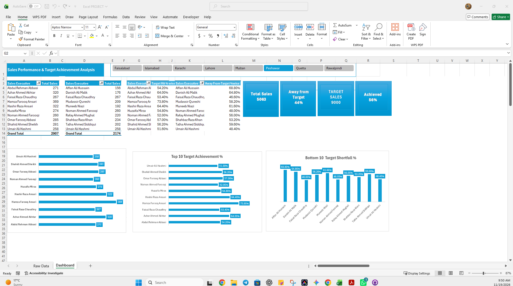

# 📊 Pakistan Sales Performance & Target Achievement Dashboard

An interactive Microsoft Excel dashboard for exploring sales executive performance and target progress across eight Pakistani cities. Built as a data analytics portfolio project, it brings key performance indicators, top and bottom performers, and city-level filtering together in one view.

---

## Project Overview

This dashboard helps users compare the highest- and lowest-performing sales executives, understand target achievement and shortfall, and explore how the selected city's results change. An interactive city slicer filters the dashboard views and KPI cards for the chosen location.

## Key Dashboard Features

- **Top 10 sales executives** ranked by total sales.
- **Bottom 10 sales executives** ranked by total sales.
- **Target achievement** for the Top 10 performers.
- **Target shortfall** for the Bottom 10 performers.
- **Four dynamic KPI cards** for Total Sales, Sales Target, Target Achievement, and Target Shortfall.
- **City slicer** covering Faisalabad, Islamabad, Karachi, Lahore, Multan, Peshawar, Quetta, and Rawalpindi.

## Tools and Technologies

| Tool or technique | How it is used |
|---|---|
| Microsoft Excel | Building and exploring the interactive dashboard. |
| PivotTables | Summarizing sales and target data for performance comparisons. |
| PivotCharts | Visualizing executive performance and target measures. |
| Slicers and report connections | Filtering dashboard views by city. |
| Excel formulas | Calculating target achievement and target shortfall. |
| Dynamic KPI cards | Presenting the selected city's key sales and target measures. |
| Linked text boxes | Displaying KPI values in the dashboard layout. |
| Dashboard formatting and visualization | Organizing charts, tables, and KPIs for clear reporting. |

## KPI Definitions

| KPI | Calculation | Business purpose |
|---|---|---|
| **Total Sales** | Sum of sales for the selected city | Measures overall sales performance. |
| **Sales Target** | Sum of sales targets for the selected city | Measures expected performance. |
| **Target Achievement %** | Total Sales ÷ Sales Target × 100 | Measures progress toward the sales target. |
| **Target Shortfall %** | 100% − Target Achievement % | Shows the remaining gap against the target. |

## Business Value

The dashboard provides a practical way to monitor sales performance, identify high- and low-performing executives, evaluate target progress, and compare results across cities. These views can also help flag where an employee may benefit from additional support; they are intended to inform review, not replace it.

## How to Use the Dashboard

1. [Download the Excel workbook](./Excel%20PROJECT.xlsx) from this repository.
2. Open it in Microsoft Excel Desktop.
3. Navigate to the **Dashboard** worksheet.
4. Use the city slicer to select a location.
5. Explore the updated KPI cards, PivotTables, and charts.

## Project Learnings

Building this dashboard gave me hands-on practice turning sales records into a useful reporting view. I strengthened my Excel skills with PivotTables, PivotCharts, formulas, slicers, and linked text boxes, while learning to arrange performance measures so users can compare results and spot target gaps more easily.

## Data Disclaimer

This is a portfolio practice project using illustrative sales records with localized Pakistani names and city labels. The data is not verified historical sales information, and the dashboard should not be interpreted as reporting actual business transactions.
